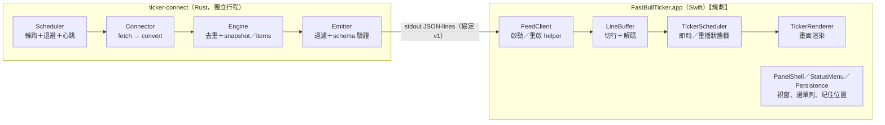
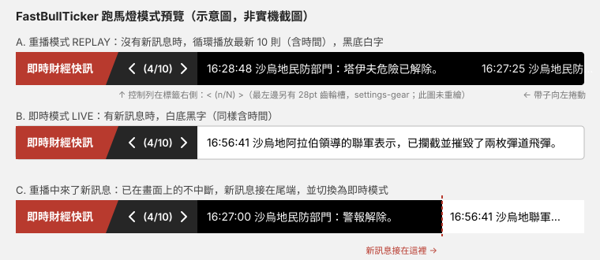

# FastBullTicker

macOS 桌面上的浮動財經快訊跑馬燈：自動抓取 [FastBull 快訊](https://www.fastbull.com/tw/express-news)（帶發布時間的即時訊息），顯示在永遠置頂的視窗上，可以拖曳位置、調整透明度。

> **這份文件分兩部分**：前半（第 1–5 節）是「怎麼用」：目標、目前狀態、環境、啟動、操作；後半（第 6–9 節）是「怎麼確認它是真的」：驗證、架構、功能規則、預覽。
> 最後更新：2026-10-24。文中標 **【規劃】** 的是還沒做出來的東西，沒有標的都已實際跑過。

---

## 1. 目標

1. **自動取得帶時間的即時訊息**：輪詢 FastBull「推薦」快訊，每則含發布時間與內文。
2. **顯示在桌面最上層**：不被其他視窗或網頁覆蓋，目標連全螢幕 App 也蓋得過去（**這一點尚未實測，見第 5.3 節**）。
3. **可調整位置與透明度**：拖曳移動；選單列滑桿調透明度；位置與透明度會記住。
4. **兩種顯示模式**：有新訊息時用白底黑字顯示；沒有新訊息時循環播放最新 10 則（含時間）。
5. **可擴充的框架**：「抓資料」（Connect engine）與「顯示」（Show engine）完全分開，中間只靠一份版本化的 JSON Schema 溝通；日後接其他網頁來源，只要新增一個連接器，顯示端不用改。

## 2. 目前狀態

**App 本體還不能執行。** 目前完成的是地基，其餘還在規劃。

| 部分 | 狀態 | 說明 |
|---|---|---|
| 訊息契約 `protocol/` | 已完成 | JSON Schema 與 45 個測試樣本 |
| 抓取程式 `ticker-connect/`（Rust） | 已完成，可單獨執行 | 輸出標準化訊息到 stdout；已對正式站手動驗證一次 |
| 顯示邏輯 `Sources/FastBullTickerCore`（Swift） | 已完成（純邏輯） | 沒有視窗，只有排程與狀態機 |
| 可行性實驗 `spikes/` | **自動部分完成，等你手動操作** | 6 項需人工的實驗尚未執行，結果全是「未執行」 |
| App 視窗、選單列、渲染、組裝簽名 | **【規劃】尚未開始** | OpenSpec change `app-shell` |

## 3. 環境需求

已實際使用的版本（這台機器）：

| 項目 | 版本 |
|---|---|
| macOS | 26.5.1（arm64；專案最低目標 macOS 14，**【假設】** 尚未在其他版本測過） |
| Xcode／Swift | Xcode 26.6／Swift 6.3.3 |
| Rust | cargo／rustc 1.98.0 |
| Python | 3.9.6（只用來跑協定的參考驗證器，標準庫加 `jsonschema` 4.25.1） |
| OpenSpec CLI | 1.5.0（只有要看或改規格時才需要） |

不需要 `sudo`，不需要任何系統權限（輔助使用、螢幕錄製都不需要）。只做 arm64，不支援 Intel。

## 4. 啟動

所有指令都在專案根目錄 `newsticker/` 開始。

### 4.1 現在就能跑：抓取程式（Rust helper）

```sh
cd ticker-connect
cargo build --release
./target/release/ticker-connect     # 結束：按 Ctrl-D（關閉 stdin）或 Ctrl-C
```

- 它會**連到正式的 FastBull 網站**，每 10 秒輪詢一次。請不要把間隔調得更短。
- 預期輸出（每行一個 JSON）：第一行是 `snapshot`（目前頁面上的 20 則，新到舊），之後每次有新訊息會出現 `items`，並且至少每 30 秒有一行 `status`（心跳）。日誌走 stderr，不會混進 stdout。
- 輸出格式範例（來自 `protocol/fixtures/valid/items-single.jsonl`）：

```json
{"v":1,"type":"items","items":[{"source":"fastbull","id":"2001","published_at_ms":1761292800000,"text":"日經指數收盤上漲，「半導體」類股領漲。日本銀行維持利率不變 😀"}]}
```

- 服務條款我們**沒有逐條閱讀**，自用低頻輪詢是否可接受，請你自己確認。

### 4.2 可行性實驗 `spikes/`（給你做人工驗證，**不是產品**）

**它是什麼**：4 支丟棄式的小程式，只用來回答「macOS 到底做不做得到」：視窗能不能蓋過全螢幕 App、點它會不會搶走你正在打字的 App 的鍵盤焦點、選單展開時動畫會不會斷、兩種渲染方式哪個比較省。答案會決定正式 App 的視窗設定。

**`swift build` 做了什麼**：只是編譯，**不會顯示任何東西**。產出是 `spikes/.build/debug/` 下的 4 個執行檔：

| 執行檔 | 回答的問題 | 會開視窗嗎 |
|---|---|---|
| `spike-s1` | 視窗蓋不蓋得過全螢幕 Safari、Keynote 等（S1） | 會 |
| `spike-focus` | 點擊或拖曳它時，會不會搶走別的 App 的鍵盤焦點（S2、S5） | 會 |
| `spike-s3` | 展開選單時，補料計時器會不會停擺（S3） | 會 |
| `spike-render` | 兩種渲染方式的 CPU／記憶體差多少（S4） | 會 |

**想先安全地看一眼（不開視窗、不用任何權限）**：

```sh
cd spikes && swift build
.build/debug/spike-s1 --dry-run --level statusBar --join-all-apps on
```

它只會印出「將會套用的視窗設定」（例如 level、collectionBehavior）後就結束。

**真正的實驗**（會開視窗，請在不被打擾的時段）：依 `spikes/README.md` 最後一節逐項執行，結果填進 `spikes/RESULTS.md`。共 7 項，其中 2 項需要外接螢幕、2 項需要插電連續跑 1 小時。**其中最重要的是第 1 項（S1，全螢幕可見性）**。

### 4.3 【規劃】App 本體（`app-shell`，開發中）

```sh
make helper && make app && make sign     # 【規劃】app-shell 完成後才有
open build/FastBullTicker.app
```

## 5. 操作（【規劃】，App 完成後的預期行為）

### 5.1 視窗

| 動作 | 預期 |
|---|---|
| 拖曳帶子 | 移動位置；下次啟動回到同一個螢幕、同一個相對位置 |
| 選單列圖示 → 透明度滑桿 | 整條帶子（含文字）一起變透明；下限約 20–30% |
| 選單列圖示 → 隱藏／顯示 | 隱藏期間帶子時間凍結，顯示後接著走 |
| 選單列圖示 → 點穿模式 | 滑鼠點擊穿過帶子到底下的 App；每次啟動一律重置為關 |
| 在帶子上按右鍵 | 與選單列同一份選單（後備入口，避免選單列圖示被擠掉） |

App 沒有 Dock 圖示，只有選單列圖示。App 不會搶走你正在輸入的 App 的鍵盤焦點。

### 5.2 訊息顯示

見第 8 節。

### 5.3 已知風險（尚未驗證）

- **蓋過全螢幕 App 沒有官方保證**：Apple 文件只定義各視窗旗標的語意，沒有保證組合效果；開發者論壇有人回報類似設定在全螢幕 Space 看不到視窗（我們沒有核對那些回報）。必須先做第 4.2 節的實驗。
- 如果某些全螢幕 App 真的蓋不過去：**只有平台限制才會被接受並記為已知限制**，我們自己的程式 bug 必須修好。
- VPN／Proxy 環境下抓取是否正常：**未驗證**。

---

## 6. 驗證

下表的數字是 2026-10-24 在 `main` 上實際重跑的結果。你可以自己重現：

| 範圍 | 指令 | 結果 | 測試檔 |
|---|---|---|---|
| 協定契約（Python 參考驗證器） | `python3 -m unittest discover -s protocol/tests` | 11 個通過 | `protocol/tests/test_contract.py` |
| 抓取程式（Rust） | `cd ticker-connect && cargo test` | 65 個通過 | `ticker-connect/tests/*.rs` |
| 顯示邏輯（Swift） | `swift test` | 101 個通過、12 個 suite | `Tests/FastBullTickerCoreTests/*.swift` |
| 實驗用腳本 | `cd spikes && swift build && tests/run_script_tests.sh` | 41 項通過 | `spikes/tests/run_script_tests.sh` |
| 規格一致性 | `openspec validate --all --strict` | 5 個 change 全部通過 | `openspec/changes/` |

### 6.1 這些測試有沒有「咬合力」

每個改了邏輯的項目都做過「故意破壞再還原」的驗證，證據都在專案裡，不是口頭宣稱：

- 協定：8 組破壞實驗（拿掉必填欄位、刪掉 `minItems`、關掉順序檢查等），每組都變紅、還原後轉綠。見 `protocol/README.md`。
- 抓取程式：17 組突變驗證。**誠實說明**：測試與實作是一起寫完，再事後做突變，不是先寫測試看它紅。見 `ticker-connect/README.md`。
- 顯示邏輯：先對空實作確認紅，再實作轉綠，另有 5 組突變。見 `Tests/README.md` 與 `Tests/evidence/`。
- 協調者另外獨立重跑：在暫存副本拿掉協定的 `minItems`，測試確實變紅；把「超過 30 則丟最舊」改成「丟最新」，對應測試確實變紅。

### 6.2 跨語言一致性

Rust 與 Swift 兩端都讀同一份 `protocol/fixtures/manifest.json`：合法樣本必須被接受、非法樣本必須被拒絕，且原因類別要與 Python 參考驗證器一致。兩端是透過這份共用 manifest 間接一致，沒有做逐筆的直接比對。

### 6.3 還沒有被驗證的事

- 所有 Swift 視窗行為（`NSPanel`、選單列、`performDrag`、`displayLink`）**只通過編譯，沒有實際執行**。
- 自動化測試**絕不連正式網站**；唯一一次連線是手動跑 35 秒，得到 1 則 snapshot（20 則）與 1 則心跳。當時沒有 VPN 或 Proxy。
- 記憶體與 CPU 的目標（App ≤35MB、helper ≤15MB）是**【假設】**，還沒有量過基準。

---

## 7. 架構



### 7.1 兩個引擎怎麼分

- **Connect engine（Rust）**：只負責「抓、轉成統一格式、去重」。不知道畫面長什麼樣子。
- **Show engine（Swift）**：只負責「排程與顯示」。不知道資料從哪個網站來，只認協定。
- 兩者之間單向溝通（helper → App），中間是版本化的 JSON Schema。它同時就是 IO 規格文件：
  - `snapshot`：第一次成功輪詢（視為歷史），新到舊。
  - `items`：之後出現的新訊息，舊到新。
  - `status`：連線健康度；至少每 30 秒一次，兼作心跳。
  - 每則訊息 `item` 只有四個欄位：`source`、`id`、`published_at_ms`（UTC 毫秒）、`text`。
- **新增來源**：實作一個 Rust `Connector`（`fetch` 抓資料、純函式 `convert` 轉格式），輸出必須通過同一份 schema。顯示端零改動。
- 抓取端負責過濾不合格的訊息（丟掉並發 `status` 警告）；接收端遇到整則有任何不合格就整則拒絕。

### 7.2 目錄

| 路徑 | 內容 |
|---|---|
| `protocol/` | JSON Schema（2020-12）、fixtures、Python 參考驗證器與測試 |
| `ticker-connect/` | Rust 抓取程式 |
| `Sources/FastBullTickerCore/`、`Tests/` | Swift 顯示邏輯（純邏輯，不依賴 AppKit） |
| `spikes/` | 丟棄式的可行性實驗與結果紀錄（`RESULTS.md`） |
| `openspec/` | 規格（5 個 change）；`docs/superpowers/specs/` 是設計文件，**與舊文件衝突時以它為準** |
| `docs/fixtures/` | FastBull 頁面快照（解析測試用） |

### 7.3 開發進度（OpenSpec，循序執行）

| 順序 | change | 狀態 |
|---|---|---|
| 1 | `message-contract` | 完成 |
| 2 | `connect-engine-fastbull` | 完成 |
| 3 | `panel-feasibility-spikes` | 5／12：自動項完成，其餘 7 項等人工 |
| 4 | `show-engine-core` | 完成 |
| 5 | `app-shell` | 0／12，其中 4 項被實驗結果阻塞 |

版本控管規則見 `CLAUDE.md` 的「Git workflow」：一個 change 一條 `change/<名稱>` 分支，驗證後用 `--no-ff` 合併進 `main`，不 force-push。

---

## 8. 功能規則

### 8.1 兩種模式

| 狀態 | 顯示內容 | 樣式 | 離開條件 |
|---|---|---|---|
| **重播 REPLAY** | 最新 10 則循環，每則含時間 | 黑底白字 | 收到新訊息 |
| **即時 LIVE** | 新訊息，依序各播一次，同樣含時間 | 白底黑字 | 即時佇列播完，回到重播 |

規則：
1. 新訊息進入即時佇列，由舊到新播放。
2. 重播中收到新訊息：**畫面上已有的訊息不中斷**，新訊息接在尾端已排入的最後一則後面，之後供料改走即時佇列。
3. 即時模式中再來新訊息：追加到佇列尾端。
4. 即時佇列播完：回到重播，重新取最新 10 則，從最新一則開始。
5. 程式啟動時抓到的既有訊息都是歷史，直接重播，不算即時。
6. 樣式跟著每一則訊息本身，不會改變已在畫面上的訊息。
7. 隱藏視窗時帶子時間凍結，顯示後接著走；隱藏期間的新訊息仍進佇列，佇列上限 30，超過丟最舊（被丟的仍會出現在最新 10 則）。

時間格式為本機時區的 `HH:mm:ss`，單則文字過長時以**量測後的寬度**截斷並加「…」。

### 8.2 v1 不做

通知、搜尋、歷史瀏覽、多來源同時顯示、設定頁、全域快捷鍵、Intel、App Store 發行與 notarization、每個螢幕各一個視窗、可調寬度、點擊開啟詳情、可調捲動速度、SQLite 持久化。

---

## 9. 預覽與待確認

### 9.1 預覽



**這是手繪的示意圖，不是實機截圖**（App 還不能執行）。圖中的標題文字取自你提供的 FastBull 頁面截圖。

### 9.2 待你確認或決定

1. FastBull 解析範圍：目前取側欄的 20 則；主內容區有 50 則（前 20 則相同）。ticker 只需要 10 則，建議維持現狀。
2. 服務條款是否接受自用低頻輪詢。
3. VPN／Proxy 環境下抓取是否正常。
4. 實驗證據（截圖、日誌）目前放在被 `.gitignore` 排除的 `spikes/out/`；建議改放可版控的 `spikes/evidence/`。
5. 所有標【假設】的暫定值（最低 macOS 14、即時佇列上限 30、記憶體門檻、視窗大小約 620×42、自用 ad-hoc 簽名等）請在實驗後一併確認。

### 9.3 更多文件

- 設計文件：`docs/superpowers/specs/2026-10-24-fastbull-ticker-design.md`
- 各元件細節：`protocol/README.md`、`ticker-connect/README.md`、`Tests/README.md`、`spikes/README.md`
- 專案規則與 Git 工作流：`CLAUDE.md`
