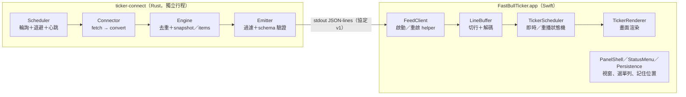

# FastBullTicker

macOS 桌面上的浮動財經快訊跑馬燈：自動抓取 [FastBull 快訊](https://www.fastbull.com/tw/express-news)，顯示在螢幕最上層的一條小帶子上。

> 這是原型軟體。**能不能跑**：在 Apple Silicon Mac 上，照下面「3 分鐘看到資料」可以建置、啟動並抓到最新 20 則快訊（作者在 macOS 26.5.1 實測過指令與日誌）。畫面外觀（顏色、捲動手感、點擊互動）只有自動測試，沒有大量實機驗證。

## 3 分鐘看到資料（快速開始）

「3 分鐘」是啟動後看到資料的時間；第一次建置另需數分鐘（見步驟 2）。

### 0. 前置需求

| 項目 | 要求 | 怎麼裝／確認 |
|---|---|---|
| 電腦 | **Apple Silicon（M1 以上）**、macOS 14 以上；不支援 Intel | `uname -m` 要印出 `arm64`。macOS 14 是專案設定的最低版本；作者只在 macOS 26.5.1 測過，其他版本【假設】可用 |
| Xcode 或 Command Line Tools | 要有 Swift 6 以上（Xcode 16+）與 `make` | 終端機執行 `xcode-select --install`（裝 Command Line Tools）；或從 App Store 裝 Xcode。作者用的是完整 Xcode；只裝 Command Line Tools 是否足以建置【假設】可以，未驗證 |
| Rust | 1.85 以上（專案用 edition 2024；作者用 1.98） | 到 <https://rustup.rs> 照指示安裝，裝完**重開終端機**，用 `cargo --version` 確認 |
| 網路 | 必須 | 第一次建置 `cargo` 會下載依賴；執行時要連 FastBull 網站 |

不需要 `sudo`，也不需要在「系統設定」授予任何權限。

### 1. 進入專案資料夾

**下面所有指令，都在「這份 README.md 所在的資料夾」裡執行**（資料夾叫什麼名字都可以）：

```sh
cd 你放這個專案的路徑
ls README.md Makefile      # 兩個檔案都印得出來，就是對的資料夾
```

### 2. 建置（只有第一次慢）

```sh
make helper app sign
```

- 做三件事：編譯 Rust 抓取程式（`helper`）、編譯 Swift App 並組成 `build/FastBullTicker.app`（`app`）、做 ad-hoc 簽名並驗證（`sign`）。
- 耗時：**約 2–3 分鐘，第一次（要下載並編譯 Rust 依賴）較久**。作者的機器上，乾淨環境 `make helper` 約 1 分 26 秒、`make app sign` 約 20 秒。
- 成功的結尾是兩行 `... valid on disk`、`... satisfies its Designated Requirement`（各出現兩組，對應 helper 與 App）。
- **不需要**先跑 `make test`（那是開發者的自動測試，很久）。
- 這個 App 是你自己在本機 build 出來的，**不會被 macOS 的 Gatekeeper 擋**，不需要 `xattr` 或右鍵「打開」。（只有「下載別人預先編好的 App」才要處理，見下方疑難排解。）

### 3. 啟動

```sh
build/FastBullTicker.app/Contents/MacOS/FastBullTicker &
```

也可以用 `open build/FastBullTicker.app` 或在 Finder 雙擊（現在切換來源不需要環境變數了）；只是直接執行比較容易在終端機看到錯誤。要看資料來源是哪個、怎麼切換，見下面「切換資料來源」。

**如果你已經有另一個 FastBullTicker 在執行**（例如上一次忘了關）：新啟動的會跳出對話框「FastBullTicker 已在執行／要關閉先前開啟的那個，改用這個嗎？」，按「關閉舊的並繼續」會**把舊的那個關掉**，按「取消」則新的退出。（對話框文字與按鈕來自原始碼；作者沒有在畫面上親眼看過對話框，只在日誌看到舊實例被關閉。）

### 4. 你應該看到什麼

- **看螢幕上方中間**：會出現一條約 648×42 的浮動小帶子，左邊是灰色齒輪、紅色斜切標籤「即時財經快訊」，右邊是由右向左捲動的快訊，每則前面有時間。整體很小，別找成整個視窗。
- **沒有 Dock 圖示**，這是正常的。App 的控制入口只有**選單列（螢幕最上方右側）的報紙圖示**。
- 剛啟動是「重播」：黑底白字循環最新幾則；之後有新快訊會以白底黑字插進來。（以上外觀描述為設計意圖，作者沒有目視確認，見下方「預期畫面」的限制。）

### 5. 怎麼確認資料真的有抓到

看日誌（路徑含空格，**一定要加引號**）：

```sh
grep 'feed:' "$HOME/Library/Application Support/FastBullTicker/app.log" | tail -5
```

看到這一行就代表資料抓到了：

```
2026-10-25T12:59:55Z feed: snapshot items=20 withUrl=20
```

意思是：第一次抓到 20 則，其中 20 則帶連結。**日誌檔是歷次啟動共用的（會累積很多行）**：請確認那行時間戳（UTC）晚於你剛啟動的時間，不要把舊的 snapshot 誤認成這次的；可用 `date -u` 對照。想直接看內容而不是筆數，請看下一節「只想看抓取程式的資料」。之後會看到 `feed: status ok`（心跳）。注意日誌時間是 UTC（結尾 `Z`），不是本機時間。看不到 `snapshot`、或只看到錯誤：見疑難排解。

想即時追蹤：`tail -f "$HOME/Library/Application Support/FastBullTicker/app.log"`（`Ctrl-C` 停止追蹤，不會關掉 App）。

> `make app` 時若印出 `fatal: not a git repository`，是因為資料夾不是用 git clone 下來的（例如解壓縮的 zip），不影響結果，版本資訊會顯示 `unknown`。
>
> **重新 build 前**：`make app`（和 `make all`）會自動先停掉所有舊的 FastBullTicker 並清掉殘留的抓取程式，不用自己處理。要發新版本就用 `make release TAG=v0.3.0`（需要工作樹乾淨，會建立 git tag）。App 內的版本資訊在 `Info.plist` 的 `BuildRevision`。

### 6. 怎麼結束

任選一種：

- 選單列報紙圖示 →「**結束**」（選單項目名稱來自原始碼；作者沒有實際點過）。
- 或終端機：`pkill -x FastBullTicker`（作者驗證過：App 與背景的 `ticker-connect` 抓取程式都會結束，抓取程式實測最多約 13 秒才消失，這段時間 `pgrep` 還看到它是正常的）。
- 確認都關了：`pgrep -fl 'FastBullTicker|ticker-connect'` 沒有任何輸出。

> **快速開始到此為止。** 下面的疑難排解之後，是給開發者看的設計與驗證細節，只想看快訊的話不必讀。週末或休市時最新一則可能停在上個交易日，那不代表壞掉。

## 只想看抓取程式的資料（不開 App）

這是除錯用：不需要 Swift，只需要 Rust。

```sh
cd ticker-connect && cargo build --release && cd ..
(sleep 15) | ./ticker-connect/target/release/ticker-connect | head -c 800
```

- `(sleep 15) |` 讓程式的輸入維持開著 15 秒，之後關閉，抓取程式就自己結束（macOS 沒有 `timeout` 指令，也不用按 Ctrl-D）。日誌走 stderr，會顯示在終端機，不會混進資料。
- **實際輸出是一行很長的 JSON**（一行約 4 KB，所以 `head -c 800` 會在中途截斷）：第一行 `{"type":"snapshot","v":1,"items":[...]}` 是目前頁面上的 **20 則**（新到舊），每則有 `source`、`id`、`published_at_ms`、`text`、`url`。之後有新訊息才會多出 `items` 行，並至少每 30 秒一行 `status`。
- 看不懂 `published_at_ms`？它是**毫秒**時間戳。去掉最後三位（除以 1000）再丟給 `date -r`：

```sh
date -r 1792919416                       # 手動去掉三位數
date -r $((1792919416428 / 1000))        # 讓 shell 算；印出 Sun Oct 25 17:10:16 CST 2026（本機時區）
```

- 它會連到正式的 FastBull 網站，每 10 秒輪詢一次，請不要自行調得更短。

## 切換資料來源（FastBull ↔ 金十）

目前有兩個來源：**FastBull**（預設）和 [金十數據](https://www.jin10.com/)。**不用開終端機、不用改程式碼**：

1. 點螢幕上方選單列的**報紙圖示**（或在跑馬燈帶子上按**右鍵**）。
2. 選「**來源**」，會展開子選單：目前使用的有 ✓，點另一個就**即時切換**——抓取程式自動重啟、舊來源的訊息被清掉、左側標籤自動換成該來源的標籤（FastBull →「即時財經快訊」，金十 →「金十數據」）。
3. 你的選擇會被記住，下次啟動（包括用 Finder 雙擊或 `open` 啟動）沿用上次選的。

**狀態**：切換流程已在真機實測一次（右鍵 → 來源 → 金十數據：標籤、抓取程式、`sources.json` 都正確更新，畫面顯示時間與標題粗體），也有自動測試（含真的 FeedClient 重啟）。**紅色重要標題的實機觀感與長時間穩定度作者還沒有看過**，請你看到後回報。

### 來源清單檔 `sources.json`

位置：`~/Library/Application Support/FastBullTicker/sources.json`（第一次啟動會自動建立）。選單裡的「**開啟來源設定檔…**」會用你的預設編輯器打開它；改完存檔，**再點一次選單就看得到**，不用重啟。

```json
{
  "version": 1,
  "selected": "fastbull",
  "sources": [
    { "id": "fastbull", "name": "FastBull 快訊", "label": "即時財經快訊" },
    { "id": "jin10",    "name": "金十數據",       "label": "金十數據" }
  ]
}
```

- `id`：對應程式裡的連接器（小寫英數與底線）；`name`：選單裡顯示的名稱（1–24 字）；`label`（選填）：左側標籤文字（1–16 字），有寫就優先於 `style.json` 的 `labelText`，且不會改寫你的 `style.json`。順序就是選單順序。
- **清單裡有、但程式沒有對應連接器的來源會顯示成灰色「（尚無連接器）」，點不動**。只貼網址不會產生新來源——每個新網站都要有人寫一個連接器，流程見 `docs/ADDING_A_SOURCE.md`。
- 檔案寫壞了（不是合法 JSON、沒有任何合法來源）：App 會把原檔備份成 `sources.json.bak`、改用預設清單，並在選單顯示提示；不會當掉。
- `selected` 指向不存在或沒有連接器的來源時，啟動會退回 FastBull（不改你的檔案）。
- 開發／測試用：環境變數 `NEWSTICKER_SOURCE=jin10` 可臨時指定來源，**優先於檔案、而且不會寫入 `selected`**；`FASTBULL_TICKER_SOURCES=/tmp/s.json` 可改用別的清單檔路徑。

### 金十的畫面與注意事項

金十 24 小時都有快訊（含週末），想確認「資料真的在更新」時用它比 FastBull 容易。

- 每則：**`HH:mm:ss`（粗體）→ 標題（粗體）→ 本文**。沒有標題的快訊只有時間與本文。來源標示為「重要」的快訊，**標題是紅色**。廣告（VIP 橫幅等）與鎖定的 PLUS 快訊會被自動略過。
- **標題和重要訊息是少數**：一次約 15–20 則裡通常只有 1–3 則有標題、0–2 則是重要訊息，所以畫面上有時整段都看不到粗體標題或紅字。想確認功能有沒有在運作，可以直接看原始資料：

  ```sh
  (sleep 15) | ticker-connect/target/release/ticker-connect --source jin10 | grep -o '"title":"[^"]*"\|"important":true'
  ```

- `withUrl=0` 或很小的數字是正常的：金十多數快訊沒有原文連結，那就不會有迴紋針；有的話點迴紋針用預設瀏覽器開啟原文（連到第三方來源網站）。
- 內容是**簡體中文原文**，不轉繁體。日誌（`app.log`）時間是 UTC，畫面上的時間是你的本機時區。
- 這是金十網站前端使用的**非官方端點**，網站改版或擋用戶端就可能失效；日誌出現 `feed: status error` 持續不退，通常就是這個原因。本專案與金十無關，**使用條款沒有逐條閱讀**，請自行確認自用低頻輪詢（10 秒一次）是否可接受；只顯示文字並連回原文。
- 想自己接別的網站：見 `docs/ADDING_A_SOURCE.md`。

### 想安全地試、不影響正在跑的 App

多開一個實例要加 `FASTBULL_TICKER_ALLOW_MULTIPLE=1`（否則會跳「已在執行」並關掉舊的）；另外 `FASTBULL_TICKER_LOG=/tmp/x.log` 改日誌位置、`FASTBULL_TICKER_SOURCES=/tmp/s.json` 與 `FASTBULL_TICKER_STYLE=/tmp/st.json` 改用暫存的設定檔、`FASTBULL_TICKER_AUTOQUIT_SECONDS=40` 讓它 40 秒後自己結束。注意兩個實例會共用 `helper.pid`，彼此可能把對方的抓取程式當成殘留而結束，所以這只適合短時間試用。

### 結束

選單列報紙圖示 →「結束」，或 `sh scripts/stop-old.sh`。

## 疑難排解

| 狀況 | 怎麼辦 |
|---|---|
| `make: command not found`、`swift: command not found` | 還沒裝 Command Line Tools：`xcode-select --install`。 |
| `cargo: command not found` | 還沒裝 Rust（<https://rustup.rs>），或裝完沒重開終端機。 |
| `make app` 說「找不到 ticker-connect」 | 先跑 `make helper`；或直接 `make helper app sign`。 |
| 螢幕上找不到帶子 | 看螢幕**上方正中間**；再用 `pgrep -fl FastBullTicker` 確認有在跑；若有多螢幕，看日誌 `panel effective: ... frame=` 的位置。看過日誌仍沒有，才是 bug。 |
| 沒有 Dock 圖示 | 正常。App 只有選單列圖示。 |
| 日誌沒有 `feed: snapshot` | 檢查網路能否打開 <https://www.fastbull.com/tw/express-news>；先用上面「只想看抓取程式的資料」確認抓取程式本身有輸出。 |
| 啟動時跳出「FastBullTicker 已在執行」 | 已有另一個實例。按「關閉舊的並繼續」會**關掉舊的**；按「取消」則保留舊的、新的退出。想直接清掉所有：`pkill -x FastBullTicker`。 |
| 想完全不連網先看看畫面 | 用離線示範 helper（不連網，輸出 12 則示意中文快訊，約每 8 秒一則新訊息）：<br>`FASTBULL_TICKER_HELPER="$PWD/scripts/demo-helper.sh" build/FastBullTicker.app/Contents/MacOS/FastBullTicker &`<br>日誌會出現 `feed: snapshot items=12`。必須用「直接執行」；`open` 不會把環境變數傳給 App。 |
| **自己 build 的 App** 被 macOS 擋？ | **不會。** 本機編譯、簽名的 App 沒有「隔離（quarantine）」標記，Gatekeeper 不會檢查。 |
| **下載 Releases 的預編譯 App** 被擋？ | 會。它沒有 Apple 開發者簽名與公證，見下一節「下載版安裝」。這個步驟**只針對下載版**。 |

## 下載版安裝（不想自己 build 時；macOS 14+、Apple Silicon）

最新版在 [Releases](../../releases)。

1. 下載 `FastBullTicker-<版本>-arm64.zip`，解壓得到 `FastBullTicker.app`，拖到「應用程式」。
2. **這個 App 沒有 Apple 開發者簽名與公證（只有 ad-hoc 簽名）**，第一次開啟 macOS 會擋。擇一處理：
   - 在 Finder 對 App 按右鍵 →「打開」→ 再按「打開」；若仍被擋，到「系統設定 → 隱私權與安全性」捲到底按「仍要打開」；或
   - 終端機執行：`xattr -dr com.apple.quarantine /Applications/FastBullTicker.app`
3. 啟動後沒有 Dock 圖示，畫面上方會出現浮動跑馬燈，選單列有報紙圖示。
4. 驗證下載完整：`shasum -a 256 FastBullTicker-<版本>-arm64.zip` 與 Release 頁面列出的雜湊相同。

下載版同樣用上面第 5 節的日誌指令確認資料（`feed: snapshot items=20`）。

> 這是原型階段的軟體：許多視覺與互動行為只通過自動測試與離屏渲染，**未經大量實機驗證**（見第 6.3 節）。

> 與 FastBull、Jin10 等資料來源網站**無任何關係**；資料來源的使用條款請自行確認，我們**沒有逐條閱讀**，自用低頻輪詢是否可接受請你自己確認。`docs/fixtures/` 內的 FastBull 頁面快照僅作解析測試資料，其內容版權屬原網站，若有疑慮請聯絡作者移除。授權：MIT（見 `LICENSE`）。

---

## 開發者／進階

**以下是開發者文件（原 README 內容，保留供查）。只想看到資料的人，上面讀完即可。** 內部用語（`change/…`、task 編號、OpenSpec）是開發流程的代號，不影響使用。已知的矛盾處以「**【註】**」標出：

- 文中「專案根目錄 `newsticker/`」指「README.md 所在的資料夾」，名稱不固定。
- 自動測試的數量（309／410／471／658）是**不同分支、不同時間點**的數字，不是矛盾也不是最新定論；以你自己跑 `swift test` 的結果為準。
- 第 4.1 節的 JSON 範例是**協定測試樣本**，不是真實輸出；真實輸出見上方「只想看抓取程式的資料」。
- 第 4.2 節 `spikes/` 是開發者的人工實驗，一般使用者不需要。
- 第 2 節狀態表中，已實作但「未目視驗證」的功能，指的是「作者沒有在螢幕前親眼確認」，不代表不能用。

> **這份文件分兩部分**：前半（第 1–5 節）是「怎麼用」：目標、目前狀態、環境、啟動、操作；後半（第 6–9 節）是「怎麼確認它是真的」：驗證、架構、功能規則、預覽。
> 最後更新：2026-10-25。文中標 **【規劃】** 的是還沒做出來的東西，沒有標的都已實際跑過。

## 1. 目標

1. **自動取得帶時間的即時訊息**：輪詢 FastBull「推薦」快訊，每則含發布時間與內文。
2. **顯示在桌面最上層**：不被其他視窗或網頁覆蓋，目標連全螢幕 App 也蓋得過去（**這一點尚未實測，見第 5.3 節**）。
3. **可調整位置與透明度**：拖曳移動；選單列滑桿調透明度；位置與透明度會記住。
4. **兩種顯示模式**：有新訊息時用白底黑字顯示；沒有新訊息時循環播放最新 10 則（含時間）。
5. **可擴充的框架**：「抓資料」（Connect engine）與「顯示」（Show engine）完全分開，中間只靠一份版本化的 JSON Schema 溝通；日後接其他網頁來源，只要新增一個連接器，顯示端不用改。

## 2. 目前狀態

**App 已有畫面程式（浮動跑馬燈、選單列、記住位置），但視覺行為我（Claude）沒有目視驗證過，需要你親眼確認。** 自動測試與受控啟動日誌都通過；請見第 4.3 節。

| 部分 | 狀態 | 說明 |
|---|---|---|
| 訊息契約 `protocol/` | 已完成 | JSON Schema 與 45 個測試樣本 |
| 抓取程式 `ticker-connect/`（Rust） | 已完成，可單獨執行 | 輸出標準化訊息到 stdout；已對正式站手動驗證一次 |
| 顯示邏輯 `Sources/FastBullTickerCore`（Swift） | 已完成（純邏輯） | 沒有視窗，只有排程與狀態機 |
| 可行性實驗 `spikes/` | **自動部分完成，等你手動操作** | 6 項需人工的實驗尚未執行，結果全是「未執行」 |
| 建置與簽名、`FeedClient`（`app-shell` 第 A 段：1.1、2.1、2.2） | 已完成（2026-10-24，自動測試通過；尚未接上畫面） | `make helper && make app && make sign` 可產生 ad-hoc 簽名的 `build/FastBullTicker.app`；`FeedClient` 以假 helper 腳本測過，**沒有連正式網站** |
| 導覽與連結（`ticker-navigation-link`：粗體時間、`(n/N)`、`<` `>`、迴紋針；分支 `change/ticker-navigation-link`，2026-10-25 實作完成） | 已實作，自動測試通過；**未目視驗證，9.1 人工驗收未做**（使用者尚未在機器前確認） | 協定 `url`、Rust 取 `data-href`、Core `seek`／閱讀位置、控制列與迴紋針渲染、命中測試、`WorkspaceURLOpener`；點迴紋針會真的開啟瀏覽器，**自動測試從未開過瀏覽器**；細節見第 5.4 節 |
| 樣式設定（`ticker-style-settings`：圓角、即時／重播配色、字級、捲動速度、訊息量、時間／標籤顯示、標籤文字；`style.json` 熱重載＋選單列「樣式」子選單；分支 `change/ticker-style-settings`，2026-10-25 實作完成） | 已實作，自動測試通過；**未目視驗證，8.1 人工驗收未做**（圓角、配色、字級的實際觀感、滑桿手感、編輯器熱重載相容性都只有自動測試與離屏 PNG） | `TickerStyle`／`StyleParser`、Core `reconfigure`、`StyleStore`（原子寫回、`.bak`、目錄監看）、外觀套用、「樣式」子選單；不改設定時畫面與原型一致（以測試斷言，**未目視比對**）；細節見第 5.5 節 |
| 齒輪與設定面板（`settings-gear`；分支 `change/settings-gear`，2026-10-25）：最左邊齒輪、點齒輪彈出非啟用設定面板、輪詢間隔、停留時間、開機自動啟動 | A 段（齒輪槽、設定值、helper 重啟、開機啟動服務）與 B 段（面板、控制項、開關與全域滑鼠監看、組裝）已實作，自動測試通過；**未目視驗證，task 12 實機驗收未做**：面板位置、非啟用面板內各控制項是否一次點擊就生效／滑桿可否拖動、開機自動啟動在 ad-hoc 簽名 App 的實際結果，都只有自動測試與離屏 PNG | 細節見第 5.6 節 |
| App 視窗、選單列、渲染（`app-shell` 第 B 段：3.1–4.2） | 已實作（2026-10-24，自動測試通過；**未目視驗證**） | 面板／選單／渲染的 level、collectionBehavior 等為**暫定值**，尚未通過全螢幕可見性實驗（S1）；離線示範 helper 見第 4.3 節 |

## 3. 環境需求

已實際使用的版本（這台機器）：

| 項目 | 版本 |
|---|---|
| macOS | 26.5.1（arm64；專案最低目標 macOS 14，**【假設】** 尚未在其他版本測過） |
| Xcode／Swift | Xcode 26.6／Swift 6.3.3 |
| Rust | cargo／rustc 1.98.0 |
| Python | 3.9.6（只用來跑協定的參考驗證器，標準庫加 `jsonschema` 4.25.1） |
| OpenSpec CLI | 1.5.0（只有要看或改規格時才需要） |

不需要 `sudo`，不需要任何系統權限（輔助使用、螢幕錄製都不需要）。只做 arm64，不支援 Intel。

## 4. 啟動

所有指令都在「README.md 所在的資料夾」開始（**【註】** 資料夾名稱不固定，不一定叫 `newsticker/`）。

### 4.1 現在就能跑：抓取程式（Rust helper）

```sh
cd ticker-connect
cargo build --release
./target/release/ticker-connect     # 結束：互動時可按 Ctrl-D（關閉 stdin）或 Ctrl-C；非互動看資料的指令見上方「只想看抓取程式的資料」
```

- 它會**連到正式的 FastBull 網站**，每 10 秒輪詢一次。請不要把間隔調得更短。
- 預期輸出（每行一個 JSON）：第一行是 `snapshot`（目前頁面上的 20 則，新到舊），之後每次有新訊息會出現 `items`，並且至少每 30 秒有一行 `status`（心跳）。日誌走 stderr，不會混進 stdout。
- 下列僅是**格式範例**（來自 `protocol/fixtures/valid/items-single.jsonl` 協定測試樣本，**不是真實輸出**：真實輸出第一行是 `snapshot`、含 20 則、每則有 `url`、欄位順序為 `type`,`v`,`items`，且整行很長）：

```json
{"v":1,"type":"items","items":[{"source":"fastbull","id":"2001","published_at_ms":1761292800000,"text":"日經指數收盤上漲，「半導體」類股領漲。日本銀行維持利率不變 😀"}]}
```

- 服務條款我們**沒有逐條閱讀**，自用低頻輪詢是否可接受，請你自己確認。

### 4.2 可行性實驗 `spikes/`（給你做人工驗證，**不是產品**）

**它是什麼**：4 支丟棄式的小程式，只用來回答「macOS 到底做不做得到」：視窗能不能蓋過全螢幕 App、點它會不會搶走你正在打字的 App 的鍵盤焦點、選單展開時動畫會不會斷、兩種渲染方式哪個比較省。答案會決定正式 App 的視窗設定。

**`swift build` 做了什麼**：只是編譯，**不會顯示任何東西**。產出是 `spikes/.build/debug/` 下的 4 個執行檔：

| 執行檔 | 回答的問題 | 會開視窗嗎 |
|---|---|---|
| `spike-s1` | 視窗蓋不蓋得過全螢幕 Safari、Keynote 等（S1） | 會 |
| `spike-focus` | 點擊或拖曳它時，會不會搶走別的 App 的鍵盤焦點（S2、S5） | 會 |
| `spike-s3` | 展開選單時，補料計時器會不會停擺（S3） | 會 |
| `spike-render` | 兩種渲染方式的 CPU／記憶體差多少（S4） | 會 |

**想先安全地看一眼（不開視窗、不用任何權限）**：

```sh
cd spikes && swift build
.build/debug/spike-s1 --dry-run --level statusBar --join-all-apps on
```

它只會印出「將會套用的視窗設定」（例如 level、collectionBehavior）後就結束。

**真正的實驗**（會開視窗，請在不被打擾的時段）：依 `spikes/README.md` 最後一節逐項執行，結果填進 `spikes/RESULTS.md`。共 7 項，其中 2 項需要外接螢幕、2 項需要插電連續跑 1 小時。**其中最重要的是第 1 項（S1，全螢幕可見性）**。

### 4.3 App 本體（`app-shell`）：啟動與預期畫面

```sh
make helper app sign                     # 產生 build/FastBullTicker.app（ad-hoc 簽名）
make test                                # 全部自動測試（等同 swift test；**【註】** 以下測試數字依分支與時間點而異，僅供參考；`change/settings-gear` B 段後為 658 個、83 個 suite；分支 `change/ticker-navigation-link` 的 N3 段後為 309 個，`change/ticker-style-settings` 的 S1 段後為 410 個、S2 段後為 471 個，`main` 較少）
```

**A. 用真 helper 啟動（會連正式 FastBull 網站，每 10 秒輪詢；需要網路）**

```sh
open build/FastBullTicker.app
```

**B. 用離線示範 helper 啟動（不連網）**

```sh
FASTBULL_TICKER_HELPER="$PWD/scripts/demo-helper.sh" build/FastBullTicker.app/Contents/MacOS/FastBullTicker &
# 結束：選單列圖示 →「結束」，或 kill 該行程。（`open` 不會把環境變數傳給 App，所以示範用直接執行。）
```

示範 helper（`scripts/demo-helper.sh`）輸出協定 v1：啟動立即送 12 則中文財經快訊示意的 `snapshot`、之後**每 8 秒一則**新的 `items`（內容以「最新快訊 #N：」開頭）、**每 25 秒一則** `status` 心跳；stdin 關閉就結束。多數訊息帶 `url`（`https://example.com/demo/<id>`，不是任何正式站，點了只會開 example.com 的示範頁），**每三則故意有一則不帶**，用來驗證「無連結不顯示迴紋針」。

**預期看到什麼（設計意圖；除下表「已驗證」外，都是未目視驗證）**

- 螢幕上方中間出現一條約 648×42 的浮動帶子；齒輪槽之後是**紅色斜切標籤「即時財經快訊」**【假設，來自你提供的參考截圖】，緊接著是 **100pt 的控制列：`<`、`(n/N)`、`>`**（nav-layout-tweaks：位於標籤右側，不再在面板右端；【假設】待你看實物後確認），再右邊是由右向左捲動的訊息（可視寬度 370pt）。最左邊是 28pt 的**齒輪設定槽**（`settings-gear`：深灰底、白灰色齒輪，點它彈出設定面板，見第 5.6 節；整個面板因此是 648pt 寬）。每則訊息開頭的時間是**粗體**，有連結的訊息最右側有**迴紋針**。
- 重播訊息：**黑底白字**；即時訊息：**白底黑字**；每則前面有 `HH:mm:ss`（本機時區）。
- 剛啟動先是重播（最新 10 則循環）；示範 helper 約 8 秒後送來新訊息，輪到它時會以白底黑字出現；這些即時訊息播完後回到黑底白字的重播，如此循環。因為訊息要排隊接在前一則後面，所以即時訊息不會在到達的瞬間出現，要等前面已排上帶子的訊息讓出位置（未量測實際延遲）。
- 選單列有報紙圖示：透明度滑桿（下限 30%【假設】）、隱藏／顯示、點穿模式、**樣式**（子選單，見第 5.5 節）、結束；在帶子上按右鍵是同一份選單。拖曳帶子移動位置；重啟後回到同一個螢幕位置與透明度。點穿模式每次啟動都是關。

| 項目 | 狀態 |
|---|---|
| 程式邏輯（夾制、debounce、選單項目、點穿不持久化、渲染位移／凍結／rebase、REPLAY→LIVE→REPLAY 串接） | **已驗證**：`swift test`，見 `Tests/README.md` |
| 面板屬性實際值（level=25 即 `.statusBar`、styleMask、不成為 key／main、alpha 等）與啟動不 crash、收到 snapshot 與 items、模式變為 live、結束時 helper 收尾無殘留 | **已驗證**：受控啟動日誌（`Tests/README.md`「真機啟動驗證」） |
| 帶子與標籤是否真的出現、顏色與文字、捲動平順度、拖曳、選單列圖示與選單操作、右鍵選單、透明度、隱藏／顯示、點穿、位置還原、中文字型；以及粗體時間、迴紋針與箭頭外觀、控制列配色、點迴紋針開瀏覽器、點箭頭跳轉、hover 暫停的實際手感 | **未目視驗證，待你確認**（離屏渲染的 PNG 我看過，見第 5.4 節，但那不等於螢幕上的實際畫面） |
| 全螢幕 App 上是否看得到、是否搶焦點、選單展開時是否斷料、長時間記憶體 | **未驗證**（level／collectionBehavior 為暫定值；屬 5.1–5.4 人工驗收） |
| 真 helper 接上畫面 | **未驗證**（本次只用示範 helper 跑；真 helper 只在第 A 段手動連過一次） |

已完成的建置與背景元件：

- `make helper`：`cargo build --release` 產生 arm64 的 `ticker-connect`。
- `make app`：用 SwiftPM 以 release／arm64 編 App，組裝 `build/FastBullTicker.app`，內含 `Contents/MacOS/FastBullTicker`、`Contents/MacOS/ticker-connect`、`Contents/Info.plist`（`LSUIElement=YES`、`LSMinimumSystemVersion=14.0`）。
- `make sign`：由內而外 ad-hoc 簽名（先 helper、再 bundle，**不使用遞迴簽名旗標**），最後 `codesign --verify --strict --verbose=2`；驗證失敗會讓 `make sign` 失敗。不 notarize、不沙盒、不需 sudo、不需任何系統權限；程式只在 `SingleInstanceGuard.swift` 的重複實例對話框呼叫 `NSApp.activate`，其餘從不呼叫。
- `FeedClient`（`Sources/FastBullTickerApp/`）：管理 helper 行程（退避重啟、卡死判定、喚醒寬限、不可恢復錯誤、優雅結束、pid file），現已由 `AppDelegate` 啟動。

可以自己驗證（不連網、不開視窗）：

```sh
sh Tests/app-packaging-check.sh          # bundle 內容、plist、codesign、改 helper 一位元組後 verify 先失敗再通過
swift test                               # 471 個（N3 段 309 個 + ticker-style-settings S1 段 101 個 + S2 段 61 個）
python3 Tests/s2-mutations.py            # 樣式套用／選單／組裝的 mutation（約 36 組；日誌 Tests/evidence/s2-mutations*.log）
python3 Tests/shell-mutations.py         # 15 組破壞→變紅→還原
```

開發／除錯用環境變數（皆為 2026-10-24 自訂的**【假設】**，正式 bundle 不依賴）：`FASTBULL_TICKER_HELPER`（覆寫 helper 路徑）、`FASTBULL_TICKER_LOG`（日誌路徑，預設 `~/Library/Application Support/FastBullTicker/app.log`）、`FASTBULL_TICKER_AUTOQUIT_SECONDS`（N 秒後自動結束）、`FASTBULL_TICKER_STYLE`（樣式檔的完整路徑，預設 `~/Library/Application Support/FastBullTicker/style.json`；測試與試用請指到暫存檔，不要動你真正的設定）。pid file 位於 `~/Library/Application Support/FastBullTicker/helper.pid`（**【假設】**）。

## 5. 操作（設計意圖；未目視驗證）

### 5.1 視窗

| 動作 | 預期 |
|---|---|
| 拖曳帶子 | 移動位置；下次啟動回到同一個螢幕、同一個相對位置 |
| 選單列圖示 → 透明度滑桿 | 整條帶子（含文字）一起變透明；下限約 20–30% |
| 選單列圖示 → 隱藏／顯示 | 隱藏期間帶子時間凍結，顯示後接著走 |
| 選單列圖示 → 點穿模式 | 滑鼠點擊穿過帶子到底下的 App；每次啟動一律重置為關 |
| 在帶子上按右鍵 | 與選單列同一份選單（後備入口，避免選單列圖示被擠掉） |

App 沒有 Dock 圖示，只有選單列圖示。App 不會搶走你正在輸入的 App 的鍵盤焦點。

**單一實例（`single-instance-guard`，設計意圖；未目視驗證）**：啟動時若已有另一個 `local.fastbull.FastBullTicker` 在執行，新啟動的那個會先跳對話框「FastBullTicker 已在執行」，按鈕「關閉舊的並繼續」（預設）／「取消」。取消 → 新的立即結束、舊的不受影響；關閉 → 對舊的正常結束，最多等 5 秒，仍在則強制結束再等 2 秒，確認消失後才啟動；關不掉會再提示並結束新的。兩個幾乎同時啟動時只有較晚啟動的那個會問【假設：以 launchDate，相同則 pid 較大者】。開發／測試時可設 `FASTBULL_TICKER_ALLOW_MULTIPLE=1`【假設：名稱】略過檢查。這個對話框是全專案**唯一**會啟用（activate）本 App 的地方，只為把對話框帶到最前面；其他操作仍不搶焦點。已知限制：舊實例的優雅結束最多約 6 秒（等 helper 收尾），而這裡只等 5 秒就強制結束，helper 可能短暫殘留，下次啟動會由 pid 檔回收；直接用 `swift run`（沒有 bundle identifier）不會做檢查。

### 5.2 訊息顯示

見第 8 節。

### 5.4 導覽與連結（`ticker-navigation-link`，設計意圖；**未目視驗證**）

| 動作 | 預期 |
|---|---|
| 看標籤右側的控制列（面板由左至右：標籤→控制列→訊息帶子） | `<`、`(n/N)`、`>`。`(n/N)` 是「閱讀中那一則」在目前清單的名次（重播＝最新 N 則的一輪，預設 N=10；即時＝當前批次，N 含尚在佇列的）。沒有閱讀中的訊息時不顯示。第一則時 `<` 淡化 |
| 點 `<` / `>` | 把前一則／下一則對齊到帶子左緣，**捲動暫停 1 秒**【假設，原 8 秒，依你第二輪回饋改】後平順恢復；再點一次重設為 1 秒。清單第一則按 `<` 無動作；`>` 在下一則尚未排入時會強制排入供料器下一個會取的那一則 |
| 點訊息最右側的迴紋針 | 以**預設瀏覽器**開啟該則完整頁面（真 helper：`https://www.fastbull.com/tw/fastshort/<id>`；示範 helper：`https://example.com/demo/<id>`）。瀏覽器成為前景【假設】，**本 App 不會被啟用**。按鈕與迴紋針都在**放開滑鼠（mouse-up）**時才觸發；按下後移到別處放開則取消 |
| 沒有 `url` 的訊息 | 不顯示迴紋針，點該處等同拖曳 |
| 滑鼠停在面板上 | 帶子暫停捲動，移出立即恢復；另以 `NSEvent.mouseLocation` 每 0.1 秒核對，避免漏掉離開事件而卡住。**點穿模式下不暫停、也不可點擊** |
| 拖曳標籤、訊息文字、`(n/N)` | 移動視窗（與以前相同）；右鍵＝同一份選單 |

已知限制與待確認：控制列使帶子可視寬度由 470 縮為 370pt（標籤隱藏時 520），長訊息更常被截斷（【待確認】要不要改成加寬面板）；`<`、`(n/N)`、`>` 的垂直對齊以離屏位圖的像素墨跡外框量測（三者差 ≤ 1 device px，見 `Tests/FastBullTickerAppTests/StripAlignmentTests.swift`），**實機觀感待你目視**；滑鼠停在帶子上（例如拖曳後忘了移開）帶子就不動，這是預設行為（【待確認】是否改成只在命中區上暫停）；mouse-up 觸發在非啟用面板上是否可靠**尚未在真機實測**（若不可靠會改成 mouse-down 觸發，那是我方實作要修的問題，不是平台限制）；`url` 在協定中是選填欄位，`v` 維持 1【假設】——新 helper 搭舊 App 會被嚴格解碼丟棄含 `url` 的訊息，兩者必須一起更新（同一個 `.app` 發行所以實務上成立）；FastBull 頁面若改版使 `data-href` 消失，會降級為沒有迴紋針，且不會發警告；FastBull 服務條款仍未逐條閱讀。

離屏渲染檢查（**不是實機畫面**）：`Tests/evidence/n3-panel-offscreen.png` 是把 `TickerView` 的圖層樹畫成 PNG（`N3_SNAPSHOT_DIR=<目錄> swift test --filter PanelSnapshot` 可重新輸出），我看過該圖：時間為粗體、迴紋針出現在有連結訊息的右側、控制列顯示 `<`、`(4/10)`、`>`（該圖是移位前的舊版面，控制列在右端，且 `<`、`>` 偏低、`(n/N)` 偏高；新版面見 `Tests/evidence/nav-layout-panel-offscreen.png`：標籤→控制列→訊息帶子，三個符號垂直對齊，同樣**不是實機畫面**）。

### 5.5 樣式設定（`ticker-style-settings`，設計意圖；**未目視驗證**）

兩條入口，改的是同一份資料：**選單列圖示 →「樣式」子選單**（快速），或**直接編輯 `style.json`**（完整）。操作立即生效、寫回檔案；用編輯器改檔存檔後約 0.3 秒熱重載。**不改設定時，畫面與原型一致**（`TickerStyle.default` 與原型逐項相同，以自動測試斷言；實機未目視比對）。

| 「樣式」子選單項目 | 內容 | 生效方式 |
|---|---|---|
| 字級 | 小 13／標準 16（預設）／大 20／特大 24 pt【假設】；手動編輯成別的值（如 17）時四項都不打勾 | **只影響之後才排入的訊息**；畫面上已有的訊息維持舊字級直到捲出（約數秒到十數秒） |
| 捲動速度 | 滑桿 20–300 px/s（預設 90），旁邊顯示整數值 | 即時，所有訊息位置在變更瞬間不跳動 |
| 訊息量 | 5／10（預設）／20 則；即重播的 N，也是 `(n/N)` 的 N | 之後的重播取料；進行中的一輪不重排 |
| 圓角 | 滑桿 0–21 pt（預設 0＝直角，與原型相同） | 即時；整個面板（含標籤與控制列）一起裁成圓角 |
| 即時配色 | 白底黑字（預設）、黃底黑字 `#FFE45C`／`#000000`、綠底白字 `#1E7B3C`／`#FFFFFF`【假設，色碼待你看實物決定】；只改即時的兩個色，不動重播配色 | 即時；畫面上已有的訊息就地重繪（位置與寬度不變） |
| 顯示時間／顯示標籤 | 勾選 | 顯示時間：只影響之後排入的訊息；顯示標籤：即時，**畫面上已有的訊息會整體左移一個標籤寬（150pt）**，帶子可視寬度由 370 增為 520 |
| 開啟樣式設定檔… | 以系統預設應用程式開啟 `style.json`（不存在就先用目前樣式建立）；被開啟的是**編輯器**成為前景，本 App 不會被啟用 | — |
| 重設為預設 | 先把現有檔案備份為 `style.json.bak`，再寫入預設值並套用；**沒有確認對話框，`.bak` 就是復原手段** | 即時 |
| （設定檔有誤時）灰色提示行 | 「設定檔有誤，沿用上次有效值」 | — |

選單操作不開任何視窗、不用對話框、不啟用 App。選單每次展開前都依目前生效的樣式更新勾選與滑桿位置（所以手動改檔、熱重載之後再展開，看到的是最新值）。

**`style.json`**（`~/Library/Application Support/FastBullTicker/style.json`；啟動時**不會**自動建立，按「開啟樣式設定檔…」或操作選單後才會出現）。缺的鍵用預設值、未知鍵會被忽略（日誌有警告），所以可以只寫要改的欄位：

| 鍵 | 型別 | 預設 | 合法範圍 | 說明 |
|---|---|---|---|---|
| `version` | 整數 | `1` | 僅 `1` | 其他值或非整數＝整份檔案無法解讀 |
| `cornerRadius` | 數字（pt） | `0` | `0`–`21` | 越界夾到邊界 |
| `fontSize` | 數字（pt） | `16` | `10`–`26` | 只影響之後排入的訊息 |
| `scrollSpeed` | 數字（px/s） | `90` | `20`–`300` | |
| `replayCount` | 整數 | `10` | `3`–`30` | `10.0` 視為 10，`10.5` 非法 |
| `showTime` | 布林 | `true` | — | 只影響之後排入的訊息 |
| `showLabel` | 布林 | `true` | — | |
| `labelText` | 字串 | `即時財經快訊` | 1–16 個字 | 前後空白修剪；空則用預設；超過 16 字截斷；標籤寬 150pt 約容 8–9 個中文字，更長以「…」截尾（**未目視驗證**） |
| `labelBackground` | 色彩 | `#D91A21` | `#RRGGBB` | 標籤底色 |
| `labelColor` | 色彩 | `#FFFFFF` | `#RRGGBB` | 標籤文字色 |
| `tapeBackground` | 色彩 | `#17171A` | `#RRGGBB` | 訊息之間空隙的底色 |
| `liveBackground` | 色彩 | `#FFFFFF` | `#RRGGBB` | 即時訊息底色 |
| `liveText` | 色彩 | `#000000` | `#RRGGBB` | 即時訊息文字色 |
| `replayBackground` | 色彩 | `#000000` | `#RRGGBB` | 重播訊息底色 |
| `replayText` | 色彩 | `#FFFFFF` | `#RRGGBB` | 重播訊息文字色 |
| `seekHoldSeconds` | 數字（秒） | `1` | `0.5`–`10` | 左右切換（`<` `>`）後停留秒數【假設】；越界夾到邊界；只影響之後的切換（`settings-gear`；設定面板「切換後停留」滑桿） |
| `pollIntervalSeconds` | 整數（秒） | `10` | 僅 `10`／`30`／`60` | helper 輪詢間隔【假設；5 秒未實測不提供】；非檔位夾到最近檔位（平手取較大）；變更時重啟 helper（`settings-gear`；設定面板「輪詢間隔」分段控制項） |

```json
{ "fontSize": 20, "scrollSpeed": 120, "cornerRadius": 10, "liveBackground": "#FFE45C", "liveText": "#000000", "replayCount": 20 }
```

規則：色彩只接受 `#` 加 6 個十六進位字元（大小寫皆可），`red`、`#FFF`、`#FFE45C80`、`FFE45C` 都算非法（該欄位用預設值並記警告）；欄位型別錯誤同樣用預設值並記警告（例如 `"fontSize": "16"`）；對比度低於 4.5 只記警告、照常套用。**色碼以 macOS 的 Generic RGB 色彩空間解讀**（原型的標籤紅與空隙底色就是這樣建構的；改用 sRGB 解讀時預設的紅色會明顯偏離原型，實測數字見 `Tests/README.md`）；視覺上與一般網頁色碼的差異未目視比對。

- **熱重載**：監看 `style.json` 所在目錄，存檔後 0.3 秒內合併處理。位元組相同、或解析後與生效樣式相同都不重套；改檔後的暫時狀態（寫到一半的不合法 JSON）**整份保留舊樣式**，日誌寫 `style: error …`，選單出現提示行，下一次存成合法內容就恢復。檔案被刪除時保留目前樣式（要回預設請用「重設為預設」）。TextEdit、`vim`、VS Code 的存檔方式（寫暫存檔再改名取代）已用「改名取代」的自動測試涵蓋，**實際編輯器的行為未目視／未實測**。
- **寫回**：選單操作立即套用，0.5 秒 debounce 後以「暫存檔＋取代」原子寫入，輸出為正規化格式（鍵排序、縮排、大寫色碼）。**限制**：寫回會丟掉檔案中的註解（JSON 本來就沒有）與未知鍵；因此磁碟上現有檔案「無法解讀」、含未知鍵、或有欄位會被改寫（夾制／型別錯誤／非法色碼）時，寫回前會先複製成 `style.json.bak`。
- **重設**：選單「重設為預設」，或自己刪掉／改寫檔案。

日誌（`FASTBULL_TICKER_LOG`）中以 `style:` 開頭的行：載入結果、`style: applied source=startup|file|menu changed=[…] viewport=… redrew=<重繪的訊息圖層數> redrawMs=<毫秒>`、警告與錯誤、寫回、備份。**重繪成本沒有在實機量測**，`redrawMs` 就是為了讓你看日誌時能判斷。

離屏渲染檢查（**不是實機畫面**）：`Tests/evidence/s2-*.png`（`S2_SNAPSHOT_DIR=<目錄> swift test --filter StyleSnapshotTests` 可重新輸出）：預設、特大字級、圓角 21、黃底黑字、隱藏標籤、組合；我看過這些圖，內容見 `Tests/README.md` S2 段。

已知限制與待確認：字級／顯示時間不重排畫面上已有的訊息（Core 不變量：排入後 `tapeX`／寬度不變），所以改字級後會有一段新舊字級並存；切換「顯示標籤」時畫面上已有的訊息會整體平移 150pt（一次性跳動，**未目視驗證**）；圓角外是透明的，**圓角外的區域不能拖曳／點擊**（視窗本身仍是矩形，這個行為未實測）；寫回會丟註解與未知鍵（見上）；預設圓角為 0（直角），若你想要預設就有圓角需另行決定；三組即時配色的色碼、字級與訊息量檔位、各欄位範圍、0.3／0.5 秒 debounce、Generic RGB 解讀色碼，皆為**【假設】**。

### 5.6 齒輪與設定面板（`settings-gear`，設計意圖；**未目視驗證，task 12 實機驗收未做**）

**怎麼用**：重新建置啟動（`make helper app sign`）後，點跑馬燈**最左邊的齒輪**，會在跑馬燈**正下方 6pt**（下方放不下就放上方，並夾在螢幕可視區內）彈出一個深色純色、圓角的設定面板；面板是**非啟用面板**，不會搶走目前前景 App 的焦點。再點一次齒輪、點面板底部的「關閉」按鈕、或在面板與跑馬燈**以外**按下滑鼠（左右鍵）都會關閉；按在跑馬燈的非齒輪處（`<` `>`、訊息、拖曳）也會關閉，但該次點擊原本的行為照常進行；跑馬燈被選單隱藏或結束 App 時一併關閉。面板外偵測用 `NSEvent.addGlobalMonitorForEvents`，**只監看滑鼠按下，不需要輔助使用（Accessibility）權限**；面板開啟時才安裝、關閉就移除。

| 面板項目 | 控制項 | 內容 | 對應 `style.json` 欄位 |
|---|---|---|---|
| 字級 | 分段 | 小 13／標準 16／大 20／特大 24（只影響之後排入的訊息） | `fontSize` |
| 捲動速度 | 滑桿＋數字 | 20–300 px/s | `scrollSpeed` |
| 圓角 | 滑桿＋數字 | 0–21 pt | `cornerRadius` |
| 重播訊息量 | 分段 | 5／10／20 則 | `replayCount` |
| 即時配色 | 分段 | 白底黑字／黃底黑字／綠底白字 | `liveBackground`、`liveText` |
| 顯示時間、顯示標籤 | 開關 | | `showTime`、`showLabel` |
| 切換後停留 | 滑桿＋秒數 | 0.5–10 秒（`<` `>` 後停留） | `seekHoldSeconds` |
| 輪詢間隔 | 分段 | 10／30／60 秒；**改變會重啟 helper**（下述） | `pollIntervalSeconds` |
| 開機自動啟動 | 開關＋狀態文字 | 顯示**實際狀態**；需核准時多一顆「開啟系統設定」 | **不寫入** `style.json` |
| 開啟樣式設定檔…／重設為預設／關閉 | 按鈕 | 同選單列「樣式」子選單的同名項目（重設會先備份 `style.json.bak`） | — |

所有樣式控制項走與選單列「樣式」子選單**同一條路徑**（`StyleMenuAction` → `StyleMenuModel.apply` → `StyleActionRunner` → `StyleStore.update`）：立即生效、0.5 秒 debounce 後寫回 `style.json`、越界值由 `StyleStore` 夾制，控制項再回到實際值；選單列「樣式」子選單保留。熱重載或選單操作之後，開著的面板會同步更新全部控制項。設定檔有問題時面板頂端顯示橘色「設定檔有誤，沿用上次有效值」。選單「樣式」子選單**不含**停留時間與輪詢間隔（只在面板）。

- **輪詢間隔會重啟 helper**：切換 10／30／60 後，`FeedClient` 以計畫性重啟換上帶 `--interval-ms` 的新 helper（預設 10 秒不帶參數）；重啟不進退避、舊 helper 先收到 stdin EOF 再升級 SIGTERM，新 helper 的 snapshot 只取代歷史、不會觸發即時模式，畫面上的訊息帶子不中斷（以假 helper 的自動測試證明：`PollIntervalSmokeTests`、`SettingsPanelSmokeTests`；**真 helper 與實機未驗證**）。其他樣式變更不會重啟 helper。
- **開機自動啟動**（`SMAppService.mainApp`，只在 `SystemLaunchAtLoginService.swift` 出現）：面板每次開啟都重新讀取實際狀態；開關位置是「呼叫後重新讀到的狀態」而不是你按了什麼。本 App 是 ad-hoc 簽名、無 team ID、未 notarize、通常不在 `/Applications`，所以 `register()` 可能直接成功、可能成功但要到「系統設定 → 一般 → 登入項目」核准、也可能丟錯，面板都如實顯示（狀態文字／錯誤訊息；錯誤以紅字顯示）。App 被移動（例如從 `build/` 搬走）後登入項目仍指向舊路徑，這是平台行為。**實際結果未驗證**（自動測試只用假服務，從不真的註冊）。
- **已知限制／風險**：(1) **非啟用面板內的 `NSSlider`／`NSSegmentedControl`／`NSSwitch` 能否第一次點擊就生效、滑桿能否拖動，是平台行為，自動測試無法證明，也沒有實機驗證**；退路（設計決定 10）：改用步進按鈕（−／＋），或讓面板可成為 key 但不啟用 App。(2) 面板層級為跑馬燈 level + 1（讓面板在跑馬燈上方），並未通過全螢幕可見性實驗。(3) 面板位置、6pt 間距、寬 330pt、深色底色、控制項外觀皆為【假設】，未目視。(4) 面板高度會隨提示行／「開啟系統設定」按鈕出現而改變（開著時就地重新定位）。(5) 設定面板的兩個真實依賴（`GlobalMouseDownMonitor` 的 `install`、`SystemLaunchAtLoginService`）從未被自動測試執行。

離屏渲染檢查（**不是實機畫面**；`GB_SNAPSHOT_DIR=<目錄> swift test --filter SettingsPanelSnapshot` 可重新輸出）：`Tests/evidence/gb-settings-default.png`、`gb-settings-approval.png`（開機啟動需核准）、`gb-settings-error.png`（設定檔有誤＋失敗訊息）。離屏時視窗不是前景，控制項以灰階（非強調色）繪製，與實機外觀可能不同。

### 5.3 已知風險（尚未驗證）

- **蓋過全螢幕 App 沒有官方保證**：Apple 文件只定義各視窗旗標的語意，沒有保證組合效果；開發者論壇有人回報類似設定在全螢幕 Space 看不到視窗（我們沒有核對那些回報）。必須先做第 4.2 節的實驗。
- 如果某些全螢幕 App 真的蓋不過去：**只有平台限制才會被接受並記為已知限制**，我們自己的程式 bug 必須修好。
- VPN／Proxy 環境下抓取是否正常：**未驗證**。
- **切換桌面（Space）時跑馬燈閃一下**（使用者回報）：已加「遮蔽防抖」（不可見須持續超過 1 秒才凍結；`ShellConfig.occludedConfirmDelay`【假設】），並在日誌加上 Space 切換／原始遮蔽狀態／防抖決定／displayLink 暫停恢復／凍結時 frame、alpha、tape 時間。**是否真的消除閃爍：未驗證，待使用者目視確認**；若仍閃，請提供 `FASTBULL_TICKER_LOG` 日誌（做法見回報；證據見 `Tests/README.md`）。

---

## 6. 驗證

下表的數字是 2026-10-25 在分支 `change/ticker-style-settings`（S2 段完成後）實際重跑的結果（協定、抓取程式與 Core 以外的數字見各列）。你可以自己重現：

| 範圍 | 指令 | 結果 | 測試檔 |
|---|---|---|---|
| 協定契約（Python 參考驗證器） | `python3 -m unittest discover -s protocol/tests` | 12 個通過（加入 `url` 後；`main` 為 11） | `protocol/tests/test_contract.py` |
| 抓取程式（Rust） | `cd ticker-connect && cargo test` | 76 個通過（加入 `url` 後；`main` 為 65） | `ticker-connect/tests/*.rs` |
| 顯示邏輯（Swift） | `swift test --filter FastBullTickerCoreTests` | Core 101 個通過、12 個 suite（`main`）；分支 `change/ticker-navigation-link` N3 段後 `swift test` 全部 309 個通過、48 個 suite（Core + App；N2 為 269，N3 新增 40 個）；`change/ticker-style-settings` S1 段後 410 個、55 個 suite（新增 101 個：Core 25〔`ReconfigureTests` 19 + `TickerLayoutTests` 4 + `SchedulerInvariantTests` 2〕、App 76〔`TickerStyleTests` 15 + `StyleParserTests` 25 + `StyleStoreTests` 檔 36〕） | `Tests/FastBullTickerCoreTests/*.swift` |
| App 層（FeedClient、打包） | `swift test --filter FeedClient`；`sh Tests/app-packaging-check.sh` | 27 個通過；打包腳本 ALL PASS | `Tests/FastBullTickerAppTests/*.swift`、`Tests/app-packaging-check.sh`；mutation 見 `Tests/README.md` |
| 樣式設定（`ticker-style-settings` S2 段） | `swift test`（全部）；`swift test --filter StyleApply`／`StyleMenu`／`StyleAction`／`AppSmokeStyle`／`StyleSnapshotTests` | 全部 **471 個、65 個 suite：470 個通過、1 個失敗**。失敗的是 `TickerStyleTests.defaultsAgreeWithShellConfigPrototypeConstants`：工作樹裡有不屬於本 change 的未提交修改 `ShellConfig.itemPadding` 14→10（原型值 14），這條斷言正是為此存在；S2 新增的 61 個全部通過。需你決定保留 10 還是還原 14 | `Tests/FastBullTickerAppTests/StyleApplyTests.swift`、`StyleMenuTests.swift`、`StyleSnapshotTests.swift`、`AppSmokeTests.swift`；細節見 `Tests/README.md` S2 段 |
| 樣式 mutation | `python3 Tests/s2-mutations.py` | 36 組破壞全部變紅（D1 第一輪存活，補測試後補跑變紅；M11 以測試行程崩潰的形式被偵測到） | `Tests/evidence/s2-mutations.log` |
| 示範 helper 協定 | `python3 Tests/demo-helper-protocol-check.py` | 實跑 6.5 秒，所有輸出行通過協定驗證（含 `url`）；snapshot 12 則中 8 則帶 `url` | `Tests/demo-helper-protocol-check.py` |
| N3 mutation | `python3 Tests/n3-mutations.py` | 22 組破壞全部變紅（第一輪 A1 存活，加強測試後補跑變紅），還原後 309 個全綠 | `Tests/evidence/n3-mutations.log` |
| 設定面板（`settings-gear` B 段） | `swift test --filter SettingsPanel`；`python3 Tests/gb-mutations.py`；`swift test`（全部） | 71 個通過；20 組 mutation 全部變紅；全部 **658 個、83 個 suite**，單次通過，但**連跑 8 次有 2 次因 `coordinatorCountsItemsWithURLFromDemoHelper`（行程啟動時序逾時）失敗**，A 段 HEAD 連跑 12 次無失敗，詳見 `Tests/README.md` | `Tests/FastBullTickerAppTests/SettingsPanel*Tests.swift`；`Tests/evidence/gb-mutations.log`、`gb-8x-swift-test.log` |
| 實驗用腳本 | `cd spikes && swift build && tests/run_script_tests.sh` | 41 項通過 | `spikes/tests/run_script_tests.sh` |
| 單一實例（`single-instance-guard`） | `swift test`（全部）；`swift test --filter SingleInstanceGuardTests`；`python3 Tests/g1-mutations.py` | 全部 **498 個、68 個 suite** 通過（新增 17）；14 組 mutation 全部變紅、存活 0 | `Tests/FastBullTickerAppTests/SingleInstanceGuardTests.swift`、`Tests/evidence/g1-mutations.log` |
| 規格一致性 | `openspec validate --all --strict` | 13 項（含主 specs 與各 change）全部通過 | `openspec/changes/` |

### 6.1 這些測試有沒有「咬合力」

每個改了邏輯的項目都做過「故意破壞再還原」的驗證，證據都在專案裡，不是口頭宣稱：

- 協定：8 組破壞實驗（拿掉必填欄位、刪掉 `minItems`、關掉順序檢查等），每組都變紅、還原後轉綠。見 `protocol/README.md`。
- 抓取程式：17 組突變驗證。**誠實說明**：測試與實作是一起寫完，再事後做突變，不是先寫測試看它紅。見 `ticker-connect/README.md`。
- 顯示邏輯：先對空實作確認紅，再實作轉綠，另有 5 組突變。見 `Tests/README.md` 與 `Tests/evidence/`。
- 協調者另外獨立重跑：在暫存副本拿掉協定的 `minItems`，測試確實變紅；把「超過 30 則丟最舊」改成「丟最新」，對應測試確實變紅。

### 6.2 跨語言一致性

Rust 與 Swift 兩端都讀同一份 `protocol/fixtures/manifest.json`：合法樣本必須被接受、非法樣本必須被拒絕，且原因類別要與 Python 參考驗證器一致。兩端是透過這份共用 manifest 間接一致，沒有做逐筆的直接比對。

### 6.3 還沒有被驗證的事

- Swift 視窗行為（`NSPanel`、選單列、`performDrag`、`displayLink`）：**已實際啟動過（受控日誌，面板屬性值正確、不 crash），但沒有人目視過畫面**；全螢幕可見性、不搶焦點、選單展開不斷料皆未驗證。
- 自動化測試**絕不連正式網站**；唯一一次連線是手動跑 35 秒，得到 1 則 snapshot（20 則）與 1 則心跳。當時沒有 VPN 或 Proxy。
- 樣式設定的實際觀感（圓角、配色、字級、滑桿手感）、`style.json` 對 TextEdit／`vim`／VS Code 存檔方式的熱重載相容性、選單展開 60 秒不斷料、「開啟樣式設定檔…」開啟的編輯器、已在畫面上的訊息就地重繪的實際成本：**皆未驗證**（只有自動測試與離屏 PNG）；`AppDelegate` 裡的正式監看器與正式 opener 沒有被任何測試執行過。
- 記憶體與 CPU 的目標（App ≤35MB、helper ≤15MB）是**【假設】**，還沒有量過基準。
- **已知問題（2026-10-25，開發暫停時記錄）**：
  - **字體顏色配對**：使用者回報「字體顏色配對還沒成功」（設定面板中顏色與文字色的搭配未達預期）。細節尚未釐清，**尚未調查、尚未修復**。
  - **測試偶發失敗**：`swift test` 連跑時，會啟動真行程的測試（假 helper、示範 helper）偶發逾時（觀察到約 1/5 至 1/4 的失敗率，單獨跑單一 suite 則穩定）。**產品功能不受影響，只影響測試可信度**；根因未證實，修復工作中途暫停，未完成的修改保存在 `git stash`（訊息 `WIP flaky-test fix`）。

---

## 7. 架構



### 7.1 兩個引擎怎麼分

- **Connect engine（Rust）**：只負責「抓、轉成統一格式、去重」。不知道畫面長什麼樣子。
- **Show engine（Swift）**：只負責「排程與顯示」。不知道資料從哪個網站來，只認協定。
- 兩者之間單向溝通（helper → App），中間是版本化的 JSON Schema。它同時就是 IO 規格文件：
  - `snapshot`：第一次成功輪詢（視為歷史），新到舊。
  - `items`：之後出現的新訊息，舊到新。
  - `status`：連線健康度；至少每 30 秒一次，兼作心跳。
  - 每則訊息 `item` 只有四個欄位：`source`、`id`、`published_at_ms`（UTC 毫秒）、`text`。
- **新增來源**：實作一個 Rust `Connector`（`fetch` 抓資料、純函式 `convert` 轉格式），輸出必須通過同一份 schema。顯示端零改動。
- 抓取端負責過濾不合格的訊息（丟掉並發 `status` 警告）；接收端遇到整則有任何不合格就整則拒絕。

### 7.2 目錄

| 路徑 | 內容 |
|---|---|
| `protocol/` | JSON Schema（2020-12）、fixtures、Python 參考驗證器與測試 |
| `ticker-connect/` | Rust 抓取程式 |
| `Sources/FastBullTickerCore/`、`Tests/` | Swift 顯示邏輯（純邏輯，不依賴 AppKit） |
| `spikes/` | 丟棄式的可行性實驗與結果紀錄（`RESULTS.md`） |
| `openspec/` | 規格（5 個 change）；`docs/superpowers/specs/` 是設計文件，**與舊文件衝突時以它為準** |
| `docs/fixtures/` | FastBull 頁面快照（解析測試用） |

### 7.3 開發進度（OpenSpec，循序執行）

| 順序 | change | 狀態 |
|---|---|---|
| 1 | `message-contract` | 完成 |
| 2 | `connect-engine-fastbull` | 完成 |
| 3 | `panel-feasibility-spikes` | 5／12：自動項完成，其餘 7 項等人工 |
| 4 | `show-engine-core` | 完成 |
| 5 | `app-shell` | 第 A 段（1.1、2.1、2.2）與第 B 段（3.1–4.2）已實作，共 7／12；5.1–5.4 為人工驗收，未做 |
| 6 | `ticker-navigation-link` | 1.1–8.1 與 10.1 已實作（9／10 項；N1–N3 三段）；**9.1 人工驗收未做**，未 archive；分支 `change/ticker-navigation-link`，尚未合併進 `main` |
| 7 | `ticker-style-settings` | 1.1–7.1 與 9.1 已實作（8／9 項；S1、S2 兩段）；**8.1 人工驗收未做**，未 archive；分支 `change/ticker-style-settings` |

版本控管規則見 `CLAUDE.md` 的「Git workflow」：一個 change 一條 `change/<名稱>` 分支，驗證後用 `--no-ff` 合併進 `main`，不 force-push。

---

### 新增資料來源

helper 與 App 以版本化的 stdout JSON-lines 協定（`protocol/`）切開，換資料來源只需要新增一個 Rust 連接器 + fixture + 測試，Swift 顯示端與協定零改動。**完整步驟、範本、陷阱與驗收表見 [`docs/ADDING_A_SOURCE.md`](docs/ADDING_A_SOURCE.md)**（寫給沒有背景的 agent，範本在 `docs/templates/`）。

- helper：`ticker-connect --list-sources` 列出已登錄來源；`--source <id>` 選擇（預設 `fastbull`，行為不變）；未知 id 退出碼 2 並在 stderr 列出可用 id。登錄表在 `ticker-connect/src/sources.rs`。
- App：以環境變數 `NEWSTICKER_SOURCE=<id>`【假設名稱】在啟動時傳給 helper 的 `--source`（未設定 = 與以前相同）；例：`NEWSTICKER_SOURCE=jin10 build/FastBullTicker.app/Contents/MacOS/FastBullTicker &`（`open` 不傳環境變數）。現在一般使用者請用選單列「來源」子選單切換（見「切換資料來源」）；左側標籤文字會隨來源（`sources.json` 的 `label`）自動改變。

## 8. 功能規則

### 8.1 兩種模式

| 狀態 | 顯示內容 | 樣式 | 離開條件 |
|---|---|---|---|
| **重播 REPLAY** | 最新 10 則循環，每則含時間 | 黑底白字 | 收到新訊息 |
| **即時 LIVE** | 新訊息，依序各播一次，同樣含時間 | 白底黑字 | 即時佇列播完，回到重播 |

規則：
1. 新訊息進入即時佇列，由舊到新播放。
2. 重播中收到新訊息：**畫面上已有的訊息不中斷**，新訊息接在尾端已排入的最後一則後面，之後供料改走即時佇列。
3. 即時模式中再來新訊息：追加到佇列尾端。
4. 即時佇列播完：回到重播，重新取最新 10 則，從最新一則開始。
5. 程式啟動時抓到的既有訊息都是歷史，直接重播，不算即時。
6. 樣式跟著每一則訊息本身，不會改變已在畫面上的訊息。
7. 隱藏視窗時帶子時間凍結，顯示後接著走；隱藏期間的新訊息仍進佇列，佇列上限 30，超過丟最舊（被丟的仍會出現在最新 10 則）。
8. 面板版面由左至右：〔齒輪槽，寬 28（settings-gear）〕→ 紅色標籤 → 控制列 `< (n/N) >`（100pt）→ 訊息帶子；帶子可視寬度 = 面板寬 − 標籤寬 − 控制列寬（648 − 28 − 150 − 100 = 370；標籤隱藏時控制列緊接齒輪槽，520）。帶子座標 0（左右切換對齊位置與「閱讀中」參考線）在控制列右緣。所有座標由單一偏移（標籤右緣）推導，見 `ControlStripLayout`。
9. 左右切換後捲動暫停 1 秒（`seekHoldSeconds`，注入時鐘計時），期間再次切換重設為 1 秒；滑鼠停在面板上時另外凍結。

時間格式為本機時區的 `HH:mm:ss`，單則文字過長時以**量測後的寬度**截斷並加「…」。

### 8.2 v1 不做

通知、搜尋、歷史瀏覽、多來源同時顯示、設定頁、全域快捷鍵、Intel、App Store 發行與 notarization、每個螢幕各一個視窗、可調寬度、App 內詳情視窗／內嵌網頁（點迴紋針改由預設瀏覽器開啟，見 5.4）、可調捲動速度、SQLite 持久化。

---

## 9. 預覽與待確認

### 9.1 預覽


**這是手繪的示意圖，不是實機截圖**（App 還不能執行）。圖中的標題文字取自你提供的 FastBull 頁面截圖。

### 9.2 待你確認或決定

1. FastBull 解析範圍：目前取側欄的 20 則；主內容區有 50 則（前 20 則相同）。ticker 只需要 10 則，建議維持現狀。
2. 服務條款是否接受自用低頻輪詢。
3. VPN／Proxy 環境下抓取是否正常。
4. 實驗證據（截圖、日誌）目前放在被 `.gitignore` 排除的 `spikes/out/`；建議改放可版控的 `spikes/evidence/`。
5. 所有標【假設】的暫定值（最低 macOS 14、即時佇列上限 30、記憶體門檻、視窗大小約 620×42、自用 ad-hoc 簽名等）請在實驗後一併確認。

### 9.3 更多文件

- 設計文件：`docs/superpowers/specs/2026-10-24-fastbull-ticker-design.md`
- 各元件細節：`protocol/README.md`、`ticker-connect/README.md`、`Tests/README.md`、`spikes/README.md`
- 專案規則與 Git 工作流：`CLAUDE.md`
